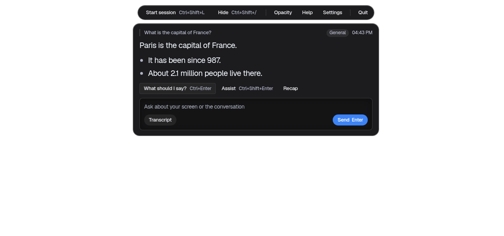

<div align="center">

# Onscreenly

**An open-source AI overlay for your desktop.** It sees your screen, hears your meeting, and answers in a small floating panel. Bring your own AI provider or run transcription locally.

[](https://github.com/paypilotlabs/onscreenly/releases/latest)
[](https://github.com/paypilotlabs/onscreenly/actions/workflows/ci.yml)
[](LICENSE)
[](docs/install.md)
[](https://github.com/sponsors/paypilotlabs)

[Download](https://github.com/paypilotlabs/onscreenly/releases/latest) · [Install guide](docs/install.md) · [Development](docs/development.md) · [Privacy](docs/privacy-and-platforms.md) · [Security](SECURITY.md)




https://github.com/user-attachments/assets/3802e939-0d4b-49a7-ab7c-2d7b222afaa6


</div>

## What it does

- **Floating overlay.** A small always-on-top toolbar and answer panel. Empty areas pass clicks through to the app underneath.
- **Screen context.** Ask about what's on your screen: code, a document, a slide. A screenshot and the recent conversation go along with your question.
- **Live transcription.** Your microphone ("You") and the meeting's audio ("Them") are transcribed on separate channels.
- **Local or cloud speech.** Use local Whisper and your audio never leaves your computer, or pick a cloud speech provider.
- **Your AI, your keys.** OpenAI, Anthropic, Gemini, Azure, Groq, Cerebras, DeepSeek, MiniMax, Ollama, or any OpenAI-compatible endpoint.
- **Meeting memory.** Transcripts, notes and a recap stay on your computer.
- **Obsidian notes.** Point it at your vault and answers can draw on your own notes, read-only.
- **Résumé and interview prep.** Import your résumé and a job description to get gaps, keyword match and practice questions.

Keyboard shortcuts:

| Action | macOS | Windows / Linux |
|---|---|---|
| Start or end a session | ⌘ ⇧ L | Ctrl Shift L |
| Stop an answer that is on its way (or click Send) | Esc | Esc |
| What should I say? | ⌘ ⌥ Enter | Ctrl Alt Enter |
| Assist | ⌘ ⇧ Enter | Ctrl Shift Enter |
| Solve the coding problem on screen | ⌘ ⌥ K | Ctrl Alt K |
| Collapse / expand the answer panel | ⌘ ⇧ / | Ctrl Shift / |
| Quit | ⌘ ⇧ X | Ctrl Shift X |

These work in every app while Onscreenly runs. Change any of them in **Settings › Appearance › Keyboard shortcuts**; a combination another app already holds is refused.

## Install

Download the file for your computer from the [latest release](https://github.com/paypilotlabs/onscreenly/releases/latest):

| Computer | File |
|---|---|
| Mac, Apple silicon | `Onscreenly-<version>-mac-arm64.zip` |
| Mac, Intel | `Onscreenly-<version>-mac-x64.zip` |
| Windows 10/11 | `Onscreenly-<version>-win-x64-setup.exe` (or `-portable.exe`) |
| Linux | `.AppImage` (x64, arm64) or `.deb` (x64) |

The builds are free and not signed with an Apple or Microsoft certificate, so macOS and Windows ask once before the first launch. The [install guide](docs/install.md) shows where to click. Every release includes `SHA256SUMS` and a build-provenance attestation you can check with `gh attestation verify`.

Requires macOS 13 or later, Windows 10/11 (64-bit), or a recent Linux desktop.

## Run from source

Node.js 22.13 or later:

```sh
git clone https://github.com/paypilotlabs/onscreenly.git
cd onscreenly
npm ci
npm start
```

On first launch, grant the microphone and screen permissions, then open Settings and choose an answer provider and a speech provider. Local Whisper, packaging and the release process are covered in [docs/development.md](docs/development.md).

## Privacy

- API keys are encrypted with your operating system's key store.
- Meeting history, notes and your profile stay on your computer. **Settings → API Keys → Your data** sets how many meetings are kept (or none) and deletes the history; **Delete all my data** removes everything.
- Screenshots, conversation context and (if you turn it on) matching Obsidian excerpts go only to the AI provider you choose.
- Screen-share hiding is **best effort**, not a guarantee. Check what others actually see in your meeting app.

Details: [docs/privacy-and-platforms.md](docs/privacy-and-platforms.md).

Use recording and assistance features with the consent of the people you're talking to, and within the rules of your meeting or activity.

## Contributing

Bug reports, fixes and docs improvements are welcome. Read [CONTRIBUTING.md](CONTRIBUTING.md) first; run `npm run check` before opening a pull request. Report security issues privately as described in [SECURITY.md](SECURITY.md), not in public issues.

## Sponsor

Onscreenly is free and built by [PayPilotLabs](https://github.com/paypilotlabs). If it saves you time, [sponsoring](https://github.com/sponsors/paypilotlabs) keeps it maintained.

## License and credits

GPL-3.0-or-later, see [LICENSE](LICENSE). Onscreenly is derived from [Cue](https://github.com/Blueturboguy07/cue) by its contributors; see [NOTICE](NOTICE) for attribution and third-party components. Upgrading from Cue: [docs/compatibility.md](docs/compatibility.md).

Copyright (C) 2026 Lohith Kumar / PayPilotLabs.
